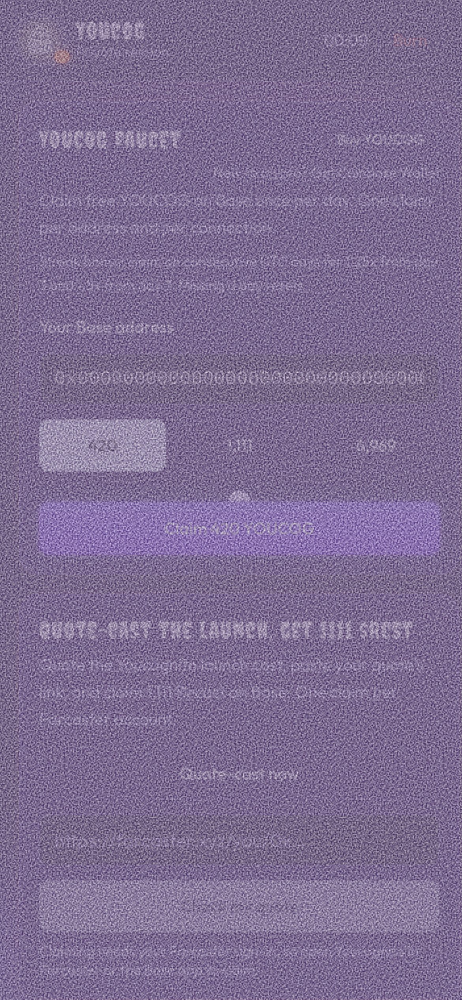

# Burn your session

Burn erases your research session in one tap.

## How to burn

1. Tap **Burn** in the top bar.
2. The button turns red and says **Erase now**. Tap it within 4 seconds to confirm.
3. A burst of static plays and the session is gone.

If you don't confirm, the button goes back to normal after 4 seconds.

## What gets erased

* Your mission text and the brief
* Every sealed tab and its contents
* The activity trail

A page refresh does the same thing. The timer next to Burn shows how long the current session has been open.

## What stays

Burn only clears your research session. These stay put:

* Faucet claims and streaks (they're on Base and in the faucet records)
* Your custom ghost picture and soundtrack on/off setting (saved in your browser)
* Anything already on-chain
