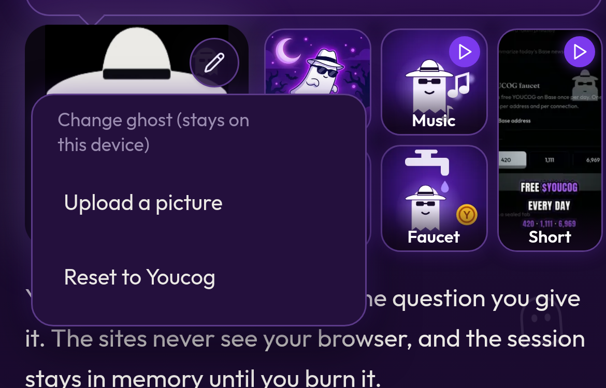

# Your own ghost picture


🟡 **Coming soon (rolling out).** This feature is finished and being deployed to the live app now. See [What's live right now](../getting-started/whats-live.md).


Make the ghost yours. Swap Youcog's face for your Farcaster profile picture or any image.

## How to change it

1. Tap the **pencil** on the big ghost.
2. Pick one:
   * **Use my Farcaster pfp** (shown inside the Farcaster Mini App)
   * **Upload a picture**: choose any image. It's cropped to a square and resized on your device.
   * **Reset to Youcog** to go back to the original ghost.

Your picture appears on the big ghost and in the top banner.

## Privacy

Your picture is **stored only in this browser** (localStorage). It is never uploaded to Youcognito's servers. That also means:

* It doesn't follow you to another phone or browser.
* Clearing your browser data resets it.
* Burning a session does **not** remove it. Use **Reset to Youcog** for that.
