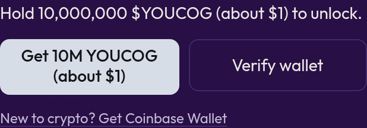

# Deep Mission (holders)

Deep Mission is a longer research report for **YOUCOG holders**: more sources, holder and liquidity analysis, a contract check, and a risk score.

## Who can use it

Anyone whose wallet holds at least **10,000,000 YOUCOG** (about $1 at recent prices). You need to prove the wallet is yours. Holding is enough; nothing is spent or locked.

## Unlock it

1. Find the **Deep Mission** card. It shows **🔒 Locked** until you're verified.
2. Don't have 10M yet? Tap **Get 10M YOUCOG (about $1)**. In Farcaster it opens an in-app swap sized for about 10M YOUCOG at the live price; on the web it opens the Bankr trade page.
3. Prove ownership:
   * **In Farcaster:** your Farcaster-verified wallets are checked automatically.
   * **On the web:** tap **Verify wallet** and sign a free message in your wallet. Signing costs nothing.
4. Once verified, the card shows **Holder**, your verified address and balance.

Verification lasts about a day, then you verify again. Your balance is re-read from Base, so if you sell below 10M the perk locks again.

## Run a Deep Mission

Type your mission (up to 600 characters) and tap **Run Deep Mission**. It can take up to a minute or two. You get a formatted report with spaced, clickable sources.

* Holders can run about **20 Deep Missions every 10 minutes**.
* For token research, Youcog adds real on-chain facts (from Base and DexScreener) and is told never to invent numbers.


The faucet wallet itself can't use holder perks. A **Holder** badge also shows next to verified holders on the [leaderboard](leaderboard-and-stats.md).

