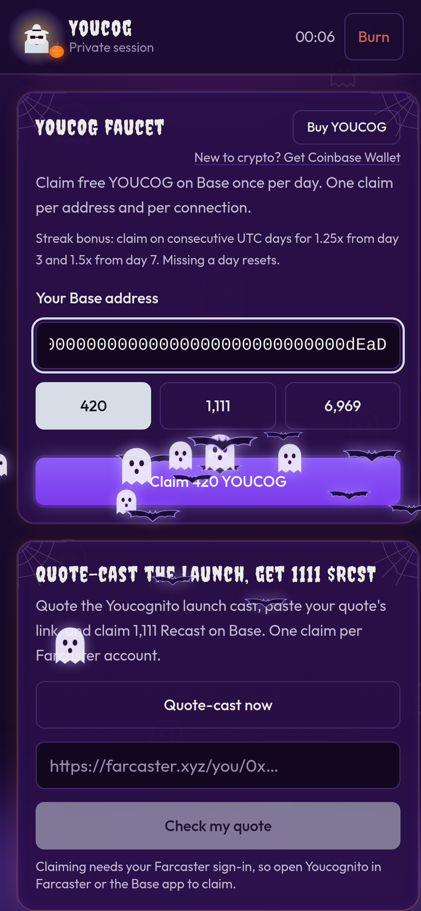

# Daily YOUCOG faucet and streaks

Claim a little YOUCOG on Base once a day. Claim on back-to-back days to earn a streak bonus.

## How to claim

1. Open **Daily YOUCOG faucet**.
2. Enter your **Base address** (starts with `0x`). In the Farcaster Mini App your connected wallet is filled in; tap **Paste a different address** to use another one.
3. Pick an amount: **420**, **1,111** or **6,969** YOUCOG.
4. Tap **Claim**. The YOUCOG is sent to you on Base, and you get a **View on Basescan** link.
5. Optional: tap **Share to Farcaster** to show off your streak.

It's free for you. The faucet pays the network fee.

## Streak bonus

Claim on consecutive days to multiply your claim:

| Streak | Bonus | 420 becomes | 1,111 becomes | 6,969 becomes |
| --- | --- | --- | --- | --- |
| Day 1–2 | 1x | 420 | 1,111 | 6,969 |
| Day 3–6 | 1.25x | 525 | 1,389 | 8,711 |
| Day 7+ | 1.5x | 630 | 1,667 | 10,454 |

* Days are **UTC days**. A new day starts at midnight UTC, which is **7 PM Central (CDT)** right now.
* **Missing a day resets** your streak to day 1.
* The claim button shows the bonus amount before you claim.
* In Farcaster your streak follows your Farcaster account. On the web it follows your address.

## The rules

* **One claim per day.** On the web: one per address and one per internet connection. In Farcaster: one per Farcaster account.
* **Daily limits.** The faucet has a daily number of claims and a daily YOUCOG budget (currently 250,000 YOUCOG a day, boosts included). When either runs out, it says so. Come back after midnight UTC.
* **While supplies last.** If the faucet wallet runs low on YOUCOG or on ETH for fees, it pauses until it's topped up.
* **Play fair.** No bots, scripts or multiple accounts. See the [Terms](privacy-and-terms.md).

## Want more?

* **Listen boost:** listen to the full *Youcognito Theme (Remix)* first and today's claim becomes **100,000 YOUCOG**. See [The 100k listen boost](listen-boost.md).
* **Buy YOUCOG:** the **Buy YOUCOG** button sits right on the faucet card. See [How to get YOUCOG](../token/how-to-buy.md).

## Common messages

| Message | What it means |
| --- | --- |
| "This address already claimed today" | Come back after midnight UTC. |
| "Someone on your connection already claimed today" | Another person on the same Wi-Fi claimed. One claim per connection on the web. In Farcaster this limit is per account instead. |
| "Today's faucet is all claimed" | The daily claim limit is reached. |
| "Today's faucet budget is nearly used up" | Try a smaller amount, or come back tomorrow. |
| "The faucet is out of gas (ETH)" | It needs a top-up. Try again later. |
