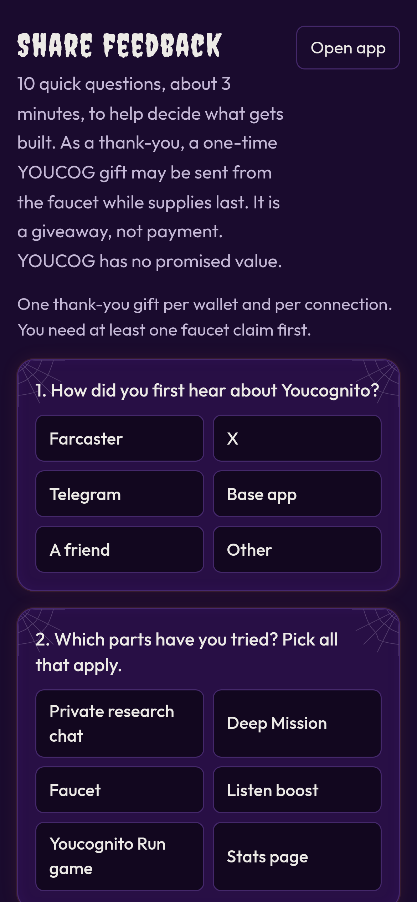

# Share feedback (thank-you gift)

Share feedback. Answer **10 quick questions** about Youcognito (about 3 minutes) to help decide what gets built. As a thank-you, a one-time YOUCOG gift may be sent from the faucet while supplies last. YOUCOG has no promised value.


**Experimental beta.** The thank-you gift is a giveaway, not payment for your answers, not income and not a reward you are owed. YOUCOG has no promised value and can go to zero. The gift can change or stop at any time. Nothing here is financial, investment, legal or tax advice. Check your local laws.


## How it works

1. On the home page, tap the **feedback** tile (or go to **youcognito.vercel.app/feedback**).
2. Answer the 10 questions. The last box is optional.
3. In Farcaster you are already signed in and your connected wallet is filled in. On the web, enter the Base address you claim the faucet with.
4. Send your feedback. If a gift is available, it is sent from the faucet wallet and you get a Basescan link.

## The fine print

* **Once per person.** One gift per Farcaster account and one per wallet, ever. On the web it is also one per connection. Multiple accounts are not allowed.
* **Faucet claimers only.** You need at least one faucet claim first (with the same Farcaster account or address).
* **Real answers.** Every question except the last one needs an answer, and short answers have to be written in words.
* **Small daily cap.** Only a few gifts go out each day across everyone. If they are used up, come back after midnight UTC.
* **Separate from the faucet budget.** Gifts come from the faucet wallet, but they are counted separately from the faucet's 500,000 YOUCOG daily budget and are not shown in the faucet totals on the stats page.
* **Balance floor.** If the faucet wallet would drop below 2,000,000 YOUCOG, gifts pause until it is topped up.
* **If the transfer fails,** your answers are still saved and you can send again.


We read every answer to decide what to build next. Answers are stored with your Farcaster ID or address so the gift is sent only once. See [Privacy and terms](privacy-and-terms.md).

