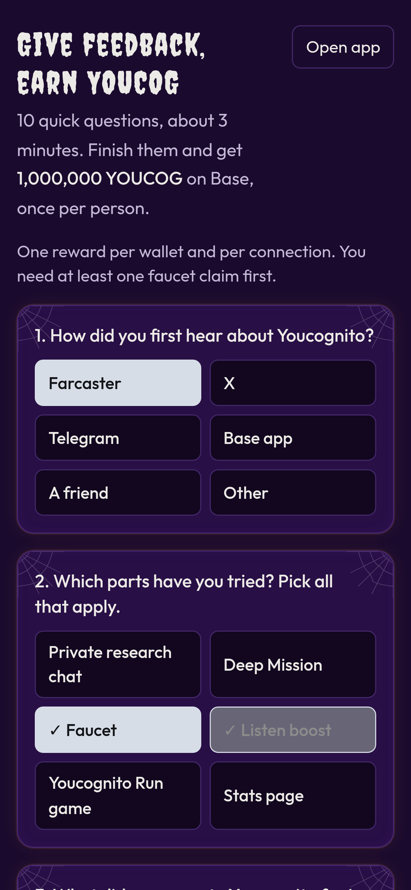

# Give feedback, earn YOUCOG

Answer **10 quick questions** about Youcognito (about 3 minutes) and get **1,000,000 YOUCOG** on Base, **once per person**.

## How it works

1. On the home page, tap the **Give feedback, earn YOUCOG** tile (or go to **youcognito.vercel.app/feedback**).
2. Answer the 10 questions. The last box is optional.
3. In Farcaster you're already signed in and your connected wallet is filled in. On the web, enter the Base address you claim the faucet with.
4. Tap **Send feedback and get 1,000,000 YOUCOG**. The YOUCOG is sent from the faucet wallet and you get a Basescan link.

## The fine print

* **Once per person.** One reward per Farcaster account and one per wallet, ever. On the web it's also one per connection.
* **Faucet claimers only.** You need at least one faucet claim first (with the same Farcaster account or address).
* **Real answers.** Every question except the last one needs an answer, and short answers have to be written in words.
* **Daily limit.** Up to 10 rewards a day across everyone. If today's are used up, come back after midnight UTC.
* **Balance floor.** If the faucet wallet would drop below 2,000,000 YOUCOG, rewards pause until it's topped up.
* **If the transfer fails,** your answers are still saved and you can send again.


We read every answer to decide what to build next. Answers are stored with your Farcaster ID or address so the reward is paid once. See [Privacy and terms](privacy-and-terms.md).

