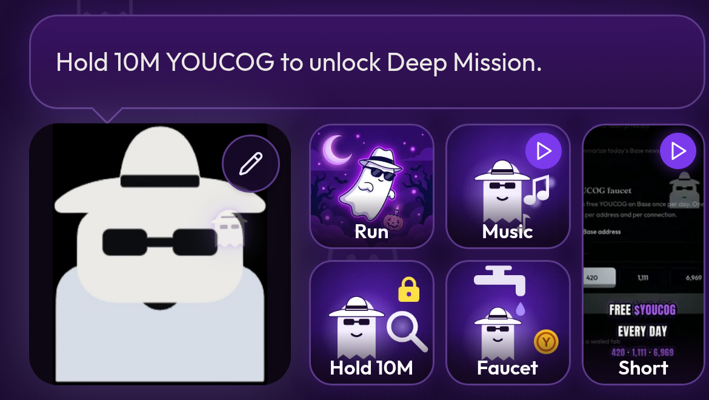

# The ghost banner and quick tiles

The top of the home screen belongs to **Youcog**, the spy ghost. It talks, points at things, and shows recent outside buys.

## The top banner

A slim banner reads **YOUCOGNITO · Private AI research on Base**, with a small animated spy ghost that tips its hat and winks. If you set [your own ghost picture](custom-ghost.md), it shows there too.

## The speech bubble

Above the big ghost, a speech bubble changes about every 5 seconds. It mixes two kinds of slides:

**Tips** about what you can do, for example:

* "Hold 10M YOUCOG to unlock Deep Mission."
* "Check in at the daily YOUCOG faucet."
* "Finish the Youcognito Theme (Remix) to unlock a bigger faucet gift today."
* "Play Youcognito Run." · "Watch the Youcognito Short." · "Turn on the spooky soundtrack."
* "Burn your session when you're done, no trace."

When a tip shows, a little ghost flies over to that feature, nods twice, and the feature glows. **Tap the bubble** to jump straight to it.

**Buy slides** (marked with a green dot) show recent on-chain buys by outside wallets, for example: *10.4M YOUCOG, 0x1a2b…9f3e, 5m ago*. They are not a recommendation. Prices change and can go to zero.

* They show **real buys only**, read from GeckoTerminal for the official YOUCOG / WETH pool.
* **Outside buyers only.** Buys by the project's own wallets (the Youcog agent and faucet wallet, and the donations wallet) are filtered out, so the bubble never shows the team buying from itself.
* Very small trades and the fee "sells" inside each buy are ignored (see [Reading the chart](../token/reading-the-chart.md)).
* Each buy slide picks one of the latest 10 outside buys. The list refreshes every couple of minutes.
* Nothing is ever made up. If there are no recent outside buys, you just see tips.

## Poke the ghost

Tap the big ghost and it wiggles and skips to the next slide. Tap the **pencil** in its corner to [change its picture](custom-ghost.md).

## Quick tiles

Next to the ghost is a grid of square tiles:

| Tile | What it does |
| --- | --- |
| **Run** | Opens the [Youcognito Run](youcognito-run.md) game |
| **Music** | Plays or pauses the [soundtrack](soundtrack.md) (shows **Playing** while on) |
| **Hold 10M** | Scrolls to [Deep Mission](deep-mission.md) |
| **Faucet** | Opens the [daily faucet](faucet.md) |
| **Short** | Opens the [YouTube Short](youtube-short.md) (the tall tile) |


If your device is set to reduce motion, the flying ghost stays put and only the glow shows.

