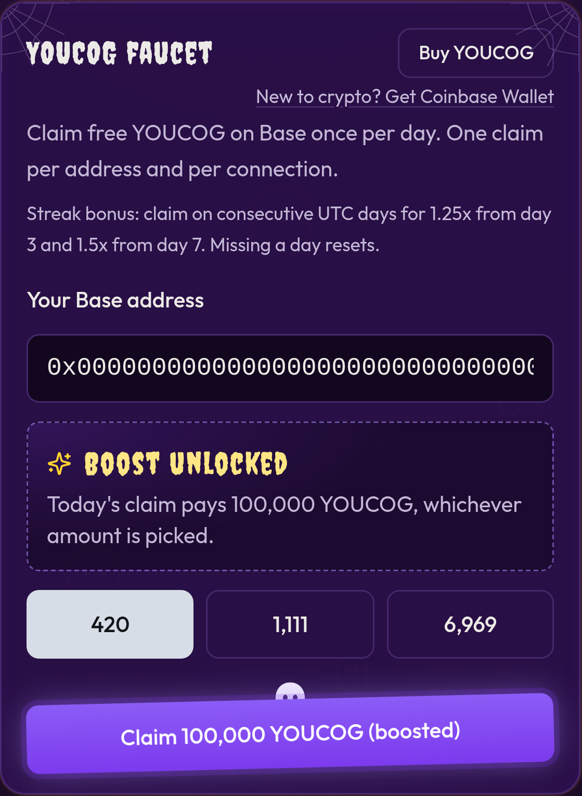

# The 100k listen boost


🟡 **Coming soon (rolling out).** The listen boost is finished and being deployed to the live app now. See [What's live right now](../getting-started/whats-live.md).


Listen to the whole **Youcognito Theme (Remix)** (3:20) and today's faucet claim pays **100,000 YOUCOG**, whichever amount you pick.

## How it works

1. Open the **Daily YOUCOG faucet** and enter your Base address (in Farcaster you're already signed in).
2. In the listen box, tap play. The song starts from the top.
3. Listen to the end. A progress bar shows how far you are. Skipping ahead doesn't count.
4. When the song ends, the server checks the listen. You'll see **Boost unlocked**.
5. Tap **Claim 100,000 YOUCOG (boosted)**.

## The fine print

* **One boost a day.** Once used, it says "You used today's listen boost. Come back tomorrow for another."
* **Server-verified.** The server starts a timer when you press play and only accepts the listen once the full song length has passed (with a few seconds of slack). It never trusts a number sent by your device. A listen has to be finished within 15 minutes after the song ends, or it expires and you start again.
* **Flat amount.** The boost replaces your normal amount. Streak bonuses aren't added on top of the 100,000.
* **Same person, same day.** The listen counts for the address you entered (or your Farcaster account), and the normal faucet rules still apply: one claim per day.
* **Daily budget.** The boost counts toward the faucet's **250,000 YOUCOG daily budget**. If not enough is left today, your claim pays the normal amount instead.
* **Balance floor.** If the faucet wallet would drop below **2,000,000 YOUCOG**, boosted claims fall back to the normal amount so the faucet doesn't run dry.
* **Fair use.** Up to 30 listen starts per person per day.

If your phone switches networks mid-song, that's fine on the web: the listen is tied to your address, not your connection.


When the song is published on SoundCloud, the boost will play through the SoundCloud player so your listen also counts as a real play there. Until then it plays from the app.

