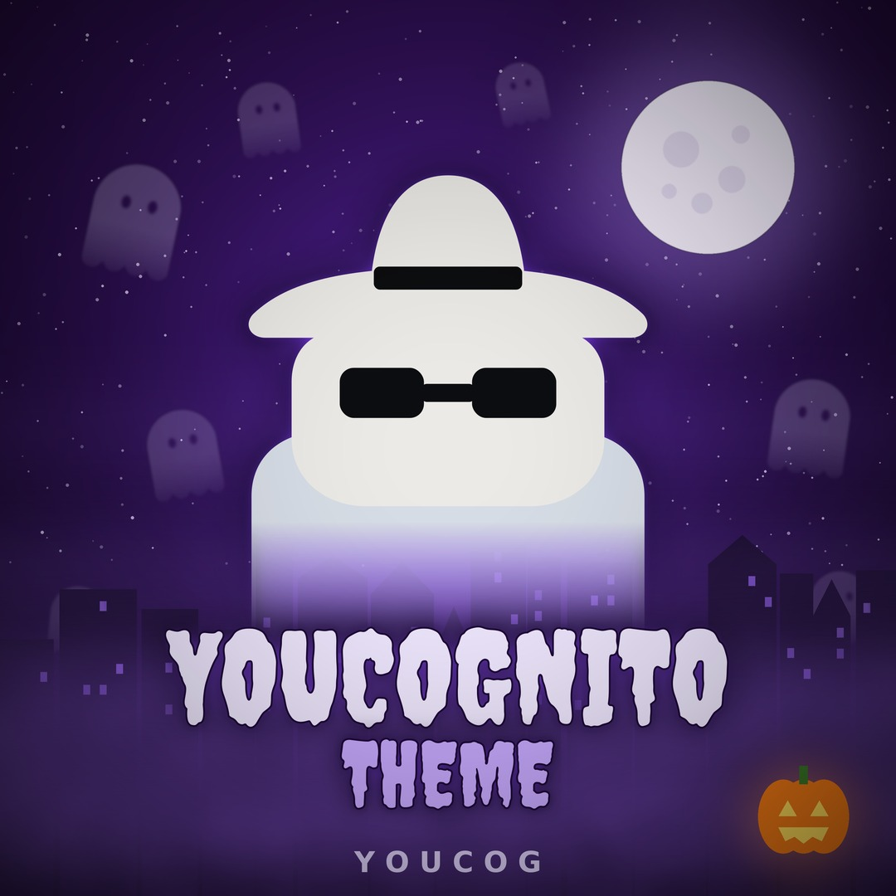
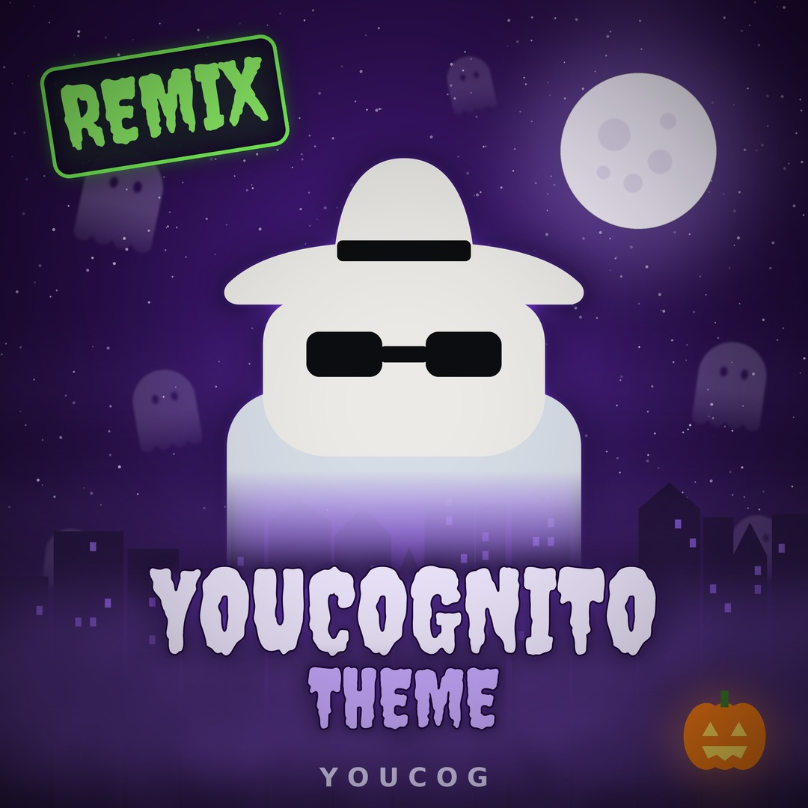

# Soundtrack: Youcognito Theme

Youcognito has its own theme song, made by Youcog.

| | **Youcognito Theme** | **Youcognito Theme (Remix)** |
| --- | --- | --- |
| Cover |  |  |
| Length | 4:12 | 3:20 |
| Artist | Youcog | Youcog |
| In the app | Not in the app (release planned) | ✅ The app's soundtrack |

## Youcognito Theme (original)

The original theme was **made entirely in code by Youcog**: no samples or loops, every sound synthesized. It's a spooky 130 BPM track in A minor with a theremin-style gliding lead, built up through intro, verses, a break and a build to **one big drop** near the end.

## Youcognito Theme (Remix)

A time-travel remix: **30 styles in about 3 minutes**, from **medieval chant** through goth Bach, Vivaldi, techno Mozart, Beethoven, Paganini, Chopin and Liszt, ragtime, blues, swing, 50s rock and roll, surf, funk, disco, synthwave, boom bap, house, jungle, drum and bass, trap, dubstep, hyperpop and **phonk**, then a build and **one big drop** at 2:42.

Every voice in the remix is **Andy's own voice**:

* It opens with half a second of silence, then **"Hey everyone, this is Youcognito!"** spoken straight.
* A skipping-record stutter follows: **YOU-YOU-YOU, IN-IN-IN, COG-COG-COG, NI-NI-NI, TO-TO-TO**, each moving around your headphones.
* Glitch edits, CD-style skips throughout ("YOU-YOU-COG", "CLAIM-CLAIM-CLAIM IT", "ON-ON-ON BASE"), extra rap verses and call-and-response hooks.
* Doo-wop style backups sing "you can claim it", made from Andy's voice pitched up into a girl-group harmony.

Listening to the whole remix unlocks the [100k listen boost](listen-boost.md).

## Playing it in the app

* Tap the **Music** tile to start or pause. It's **off by default** and never autoplays.
* It loops, plays quietly (35% volume), and pauses when you switch tabs.
* Your on/off choice is remembered in this browser. If it was on, it resumes on your first tap.
* If the audio can't load, the Music tile hides itself.

## On SoundCloud

*Youcognito Theme (Remix)* is on [SoundCloud](https://soundcloud.com/greentime1/youcognito-theme-remix). The [100k listen boost](listen-boost.md) plays through the SoundCloud player, so boost listens count as real plays there. The **Music** tile still plays the same remix from the app as quiet background music.
