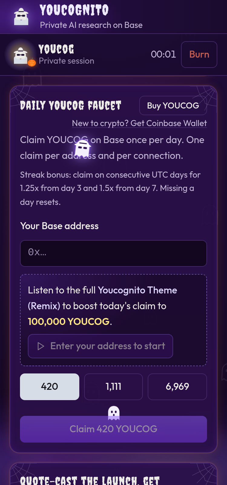

# Quick start

Youcognito works in any modern browser. Nothing to install, no account needed to look around.

## 1. Open the app

Go to [youcognito.vercel.app](https://youcognito.vercel.app), or open **Youcognito** inside Farcaster (see [Web app or Farcaster Mini App](web-or-mini-app.md)).


If X shows a warning when you tap the app link, use [linktr.ee/youcognito](https://linktr.ee/youcognito) instead. See the [FAQ](../project/faq.md#why-does-x-warn-about-the-link).


## 2. Ask Youcog something

Type a question into **Mission** and tap **Run Youcog**. Youcog searches the web for you and writes a short brief with its sources. Tap a source to read it in a **sealed tab**.

Not sure what to ask? Try a suggestion, like *"What is the YOUCOG token on Base?"* or *"Summarize today's Base news"*.

## 3. Claim your daily YOUCOG

Open **Daily YOUCOG faucet**, enter your Base address (or use your connected wallet in Farcaster), pick **420**, **1,111** or **6,969**, and tap **Claim**. Come back tomorrow to build a streak. See [Daily faucet and streaks](../features/faucet.md).

## 4. Burn when you're done

Tap **Burn**, then **Erase now**. Your session is gone. See [Burn your session](../features/burn.md).

## What you need

| To do this | You need |
| --- | --- |
| Research and sealed tabs | Nothing |
| Claim from the faucet | A Base wallet address (starts with `0x`) |
| Deep Mission | A wallet holding at least 10,000,000 YOUCOG (about $1), and a quick signature to prove it's yours |
| Tips | A wallet with a little ETH or USDC on Base |

New to crypto? The app links to **Coinbase Wallet** next to the Buy buttons.
